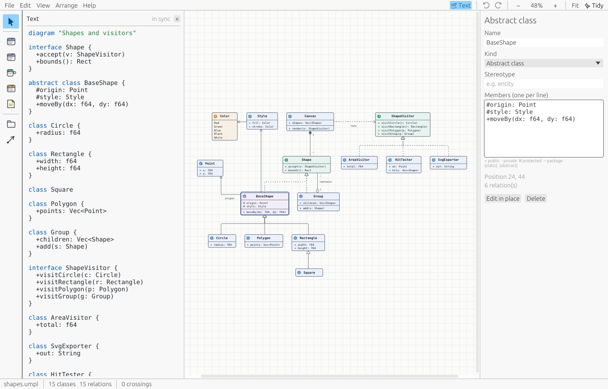

# fastumpl

A desktop editor for UML class diagrams that lays them out for you. It places the boxes and routes every line around them, keeping line crossings to a minimum. Written in Rust.



- **Tidy in one key.** Ctrl+T lays out the whole diagram: parents above children, related classes side by side, no overlapping boxes, no lines through boxes.
- **Few crossings.** Crossings are removed at several stages, from box order to line routing, and several candidate layouts compete. The status bar shows the crossing count.
- **Lines follow you.** Drag a class and its lines re-route as you move.
- **Type, don't click.** Double-click a class and type its members: `+total(): Money`.
- **Text and drawing side by side.** The text panel shows the diagram as `.umpl` text. Edit either one and the other follows as you work: type a class or a relation and it appears, laid out; drag, rename or delete on the canvas and the text updates. Show or hide the text with View → Text or Ctrl+B; it starts hidden.
- **Plain text files.** Diagrams are `.umpl` text files that diff well. The model sits at the top and positions at the bottom.
- **Command line too.** `umpl` renders SVG and PNG, formats and checks files.
- **PlantUML and Mermaid.** Open `.puml` files directly; export to PlantUML or Mermaid, or copy Mermaid to paste into a GitHub README or issue.
- **Umple.** Open the class model of an [Umple](https://umple.org) `.ump` file and see it laid out; export a diagram as Umple for the Umple compiler to generate code from.

## Download

From the [latest release](../../releases/latest):

| Platform | Files |
|---|---|
| Windows x64 | `fastumpl-windows-x86_64-setup.exe` (installer) or `fastumpl-windows-x86_64-portable.zip` |
| Windows ARM64 | `fastumpl-windows-arm64-setup.exe` or `fastumpl-windows-arm64-portable.zip` |
| macOS 11+ (Apple Silicon and Intel) | `fastumpl-macos-universal.dmg`; first launch: right-click the app, then Open |
| Linux x86-64 | `fastumpl-linux-x86_64.deb` (`sudo apt install ./fastumpl-linux-x86_64.deb`) or `fastumpl-linux-x86_64.tar.gz` (glibc 2.35+) |

The installer adds a Start menu entry, the `.umpl` file type and, optionally, `umpl` on PATH. The portable zip installs nothing and keeps its data in a `data` folder next to the program.

## The `.umpl` format

```
diagram "Shop"

package billing {
  abstract class Payment {
    +amount: Money
    +pay(): Receipt {abstract}
  }
  class CardPayment
}

class Order {
  +id: OrderId
  -lines: List<OrderLine>
  +total(): Money
}

enum Status { New, Paid, Shipped }

# an order owns its lines
Order "1" *-- "1..*" OrderLine : contains
billing.CardPayment --|> billing.Payment
Order --> billing.Payment : paid by

layout {
  Order           at 29, 17
  billing.Payment at 3, 5
}
```

| Arrow | Meaning |
|---|---|
| `A --\|> B` | A extends B |
| `A ..\|> B` | A implements B |
| `A *-- B` | A is composed of B |
| `A o-- B` | A aggregates B |
| `A -- B` | association |
| `A --> B` | directed association |
| `A ..> B` | A depends on B |
| `N .. A` | note N describes A |

Reversed arrows such as `<|--` are accepted too. Each end can carry a quoted label, `"1..*"` or `"0..1 owner"` (multiplicity, then role). Elements without a line in the `layout` block are placed automatically when the file opens. Lines the parser does not understand are kept and written back unchanged.

## The text panel

The panel on the left shows the model part of the file (everything above `layout`) and is kept in step with the drawing both ways:

- **Text to drawing.** A quarter of a second after you stop typing, the text is read again and the diagram updated. A class you rename keeps its place and its selection; a new class is placed in a free spot; a class whose line you delete and retype gets its place back. While a `{` is still open the diagram waits (the panel says so), so a half-typed class body does not swallow the classes below it. Lines that are not understood get a red background and are listed under the text.
- **Drawing to text.** Changes on the canvas, in the inspector, and undo or redo rewrite the text. Moving boxes does not, since positions are not shown; a `layout` block typed into the panel is still applied.
- **Undo.** Typing is one undo step until you pause for two seconds or leave the panel. Inside the panel Ctrl+Z undoes typing; outside it, the step ("Undo Edit text").

## Command line

```
umpl render diagram.umpl -o diagram.svg      # or .png; --tidy, --dark, --scale N
umpl tidy diagram.umpl                       # lay out again and save positions
umpl fmt [--check] diagram.umpl              # rewrite in standard style
umpl check diagram.umpl                      # list problems, exit 1 if any
umpl stats diagram.umpl [--tidy]             # crossings, bends, score
umpl convert diagram.puml -o diagram.umpl    # import PlantUML; --tidy stores a layout
umpl convert model.ump -o model.umpl        # import Umple
umpl convert diagram.umpl -o diagram.mmd     # export: .mmd, .md (Mermaid block), .puml, .ump
umpl convert diagram.umpl --to mermaid       # write to standard output
```

`render`, `check` and `stats` also read PlantUML files (`.puml`, `.plantuml`, `.pu`, `.iuml`, `.wsd`) and Umple files (`.ump`).

## PlantUML and Mermaid

- **Import.** Open a PlantUML class diagram (File → Open, drag and drop, or `fastumpl model.puml`). It opens as a new, unsaved diagram and is laid out at once; Save writes a `.umpl` file and leaves the PlantUML file alone. Styling commands such as `skinparam` and `hide` are skipped and listed under Problems.
- **Export.** File → Export → PlantUML… and Mermaid… (`.mmd`, or `.md` for a ready-made ```` ```mermaid ```` block). **Copy as Mermaid** puts the diagram on the clipboard for pasting into Markdown on GitHub, GitLab, Notion or Obsidian.
- Both formats lay diagrams out themselves, so positions are not exported.

## Umple

[Umple](https://umple.org) writes class models as text (classes, attributes, associations such as `1 -- * Student;`, `isA`) next to state machines and method code, and generates Java, Python and other languages from them.

- **Import.** Open a `.ump` file the same way as a PlantUML file. Classes, interfaces, enums, traits, attributes, methods (signatures only), associations, association classes, `isA` and namespaces (as packages) are read, and the diagram is laid out at once. State machines, constraints, requirements, mixsets, ports and other files named by `use` are not drawn; each is listed under Problems. UmpleOnline's `position` lines are ignored in favour of fastumpl's own layout.
- **Export.** File → Export → Umple… writes a `.ump` file the Umple compiler can read: packages become `namespace` statements, associations go into class bodies, and an association without a multiplicity gets `*`. Notes, dependencies, aggregation and anything else Umple cannot express become comments, so nothing is silently dropped.
## Keys

| Key | Action |
|---|---|
| Double-click empty space | New class |
| Double-click a box | Edit it in place |
| Drag from a dot on a box edge | Connect (pick the relation kind) |
| V C A I E N P R | Tools: select, class, abstract, interface, enum, note, package, relation (also the icons on the left) |
| Ctrl+T | Tidy |
| F | Fit diagram in window |
| Ctrl+K | Command palette |
| Ctrl+B | Show or hide the text panel (also View → Text) |
| Ctrl+Z / Ctrl+Shift+Z (or Ctrl+Y) | Undo / redo; also the ⟲ ⟳ buttons, and the Edit menu names the step ("Undo Move Order") |
| Right- or middle-drag, scroll, the scroll bars | Pan |
| Ctrl+scroll, or − and + in the top bar | Zoom (click the percentage for 100 %) |

## Building

Everything builds in Docker, so nothing else needs installing on your machine:

```
make linux-x86_64              # build (binaries for glibc 2.35+)
make linux-x86_64-deb          # dist/fastumpl-linux-x86_64.deb
make linux-x86_64-packages     # .tar.gz and .deb
make windows-x86_64            # build
make windows-x86_64-packages   # portable .zip and installer (Inno Setup 7)
make windows-arm               # build for ARM64
make windows-arm-packages      # portable .zip and installer for ARM64
make mac                       # dist/fastumpl-macos-universal.dmg (needs your macOS SDK)
make all                       # all packages except mac
make test
make clean                     # remove dist/, target/ and generated files
```

`make mac` needs Apple's macOS SDK, which may only be used on Apple hardware and is not included; see [packaging/macos/README.md](packaging/macos/README.md). Release `.dmg` files are built on GitHub's macOS runners.

For development, `scripts/dev.sh` runs any command in the same image with the repository mounted and the display forwarded (X11, including WSLg), so the editor window opens on your desktop:

```
scripts/dev.sh cargo test --workspace
scripts/dev.sh cargo run -p umpl-app -- examples/library.umpl
```

| Crate | Role |
|---|---|
| `umpl-core` | Document model and undoable edits |
| `umpl-text` | `.umpl` parser and printer |
| `umpl-layout` | Layered placement, orthogonal routing, crossing minimisation |
| `umpl-draw` | Box measuring, shapes, SVG and PNG |
| `umpl-cli` | The `umpl` command |
| `umpl-app` | The editor (egui) |

The design is in [docs/design.md](docs/design.md). Layout quality is guarded by a corpus test (`tests/corpus/scores.txt`): a change that adds crossings or worsens the score fails the build.

Releases: every push to `main` builds all packages (with the `make` targets above, plus the `.dmg` on macOS) and publishes release `v0.1.N`, where N is the number of commits on `main`. CI runs only on `main`; pull requests do not trigger it. The website in `site/` is published to GitHub Pages from `main` (set Pages to "GitHub Actions" once in the repository settings).

## License

MIT; see [LICENSE](LICENSE). The bundled DejaVu Sans Mono fonts have their own permissive license in [assets/fonts/DejaVu-LICENSE.txt](assets/fonts/DejaVu-LICENSE.txt).
